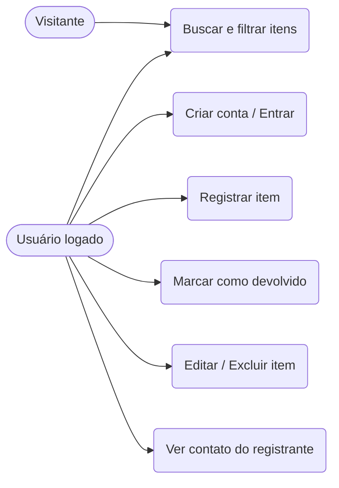
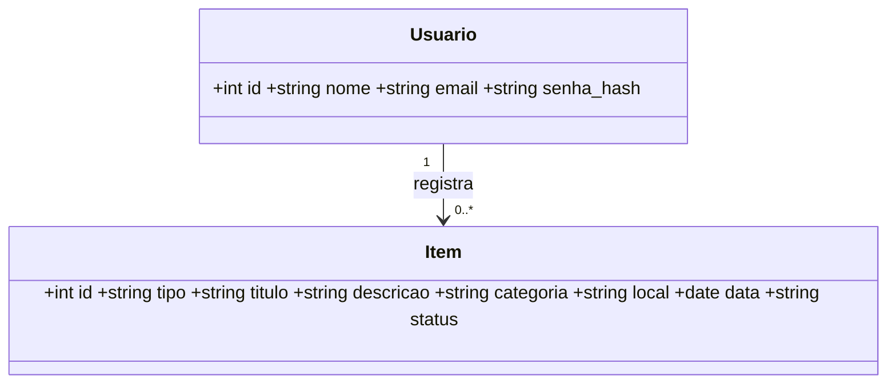
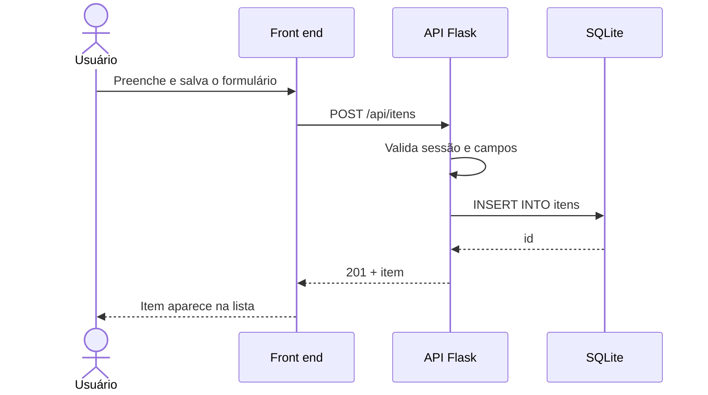

# Documentação — Achados e Perdidos UNIMA

## 1. Planejamento (Etapa 1)
- **Software:** Achados e Perdidos UNIMA
- **Problema:** objetos perdidos no campus não têm um canal único; a devolução depende de avisos dispersos.
- **Objetivo geral:** permitir que a comunidade acadêmica registre, busque e acompanhe a devolução de objetos perdidos e achados.
- **Stakeholders:** alunos (principais usuários), professores e funcionários, equipe da secretaria/segurança do campus (potenciais moderadores), coordenação/TI.
- **Escopo:** inclui cadastro/login, CRUD de itens, busca e filtros, marcação de devolução. Não inclui: notificações por e-mail, upload de fotos, painel administrativo.
- **Modelo de desenvolvimento:** **Incremental/ágil (Kanban)**. O escopo é pequeno e as funções são independentes, então foram entregues em incrementos (conta → itens → busca → devolução), com o quadro Trello nas colunas A fazer / Em andamento / Em testes / Concluído.

## 2. Requisitos (Etapa 2)
**Técnica de levantamento:** _descrever a que o grupo usou (ex.: questionário com colegas, observação do fluxo atual de avisos em grupos de mensagens)_. Observamos sistemas de achados e Perdidos e eles não são práticos e receptivos, por isso criamos algo pratico e de fácil uso para qualquer um

| ID | Requisito funcional | Implementado |
|---|---|---|
| RF01 | O sistema deve permitir criar conta e autenticar usuários. | Sim |
| RF02 | O sistema deve permitir registrar item perdido ou achado, informando contato por e-mail, telefone/WhatsApp ou ambos. | Sim |
| RF03 | O sistema deve permitir listar, buscar e filtrar itens. | Sim |
| RF04 | O sistema deve permitir marcar um item como devolvido. | Sim |
| RF05 | O sistema deve permitir editar e excluir os próprios registros. | Sim |

| ID | Requisito não funcional | Implementado |
|---|---|---|
| RNF01 | A interface deve ser responsiva (computador e celular). | Sim |
| RNF02 | Senhas devem ser armazenadas com hash e o contato só aparece para usuários logados. | Sim |

## 3. Modelagem UML (Etapa 3)
Diagramas em Mermaid (renderizam no GitHub; também podem ser colados em mermaid.live para exportar imagem).

### Casos de uso

### Classes

### Sequência — registrar item

## 4. Protótipo (Etapa 4)
Esboço das 3 telas principais (refazer no Figma/Canva/Draw.io e salvar as imagens em `docs/img/`):
1. **Tela inicial:** título, busca, filtros (tipo, categoria, situação), botão "Registrar item" e lista de cartões.
2. **Entrar / Criar conta:** modal com nome (só no cadastro), e-mail e senha.
3. **Registrar item:** modal com tipo, título, descrição, categoria, local e data.

## 5. Testes (Etapa 6)
Execução: `python tests/test_api.py` — **7 de 7 testes aprovados** (executados na entrega desta versão).

| ID | Funcionalidade | Procedimento | Resultado esperado | Resultado obtido | Situação |
|---|---|---|---|---|---|
| CT01 | Cadastro e login (RF01) | Cadastrar usuário, repetir o e-mail, entrar com senha errada e correta | Duplicado → 409; senha errada → 401; correta → 200 | Conforme esperado | Aprovado |
| CT02 | Registrar item (RF02) | Registrar sem login, com login e com título vazio | 401; 201 e item na lista; 400 | Conforme esperado | Aprovado |
| CT03 | Busca e filtros (RF03) | Buscar por texto, tipo e categoria; buscar termo inexistente | Resultados corretos; lista vazia para termo inexistente | Conforme esperado | Aprovado |
| CT04 | Devolução (RF04) | Outro usuário tenta devolver; o dono devolve | 403; 200 e status "devolvido" | Conforme esperado | Aprovado |
| CT05 | Editar e excluir (RF05) | Editar título e excluir | Título atualizado; lista vazia | Conforme esperado | Aprovado |
| CT06 | Privacidade (RNF02) | Listar como visitante e como logado | Contato oculto; contato visível | Conforme esperado | Aprovado |
| CT07 | Contato por e-mail, telefone ou ambos (RF02) | Registrar sem contato, só com telefone, só com e-mail, com telefone inválido e com ambos | 400; 201; 201; 400; 201 | Conforme esperado | Aprovado |

> Os testes automatizados cobrem a API. Testar também a interface manualmente no navegador e registrar o resultado.
